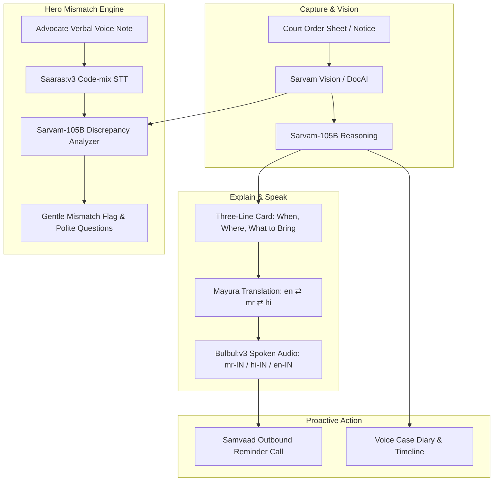

https://build-with-sarvam-ai-brejghj9ex8d2otycepgyj.streamlit.app/


# ⚖️ Tareekh (तारीख)
> **Court order sheets into clear voice in your own language.**  
> *Know your next date, what to bring, and whether your lawyer’s verbal update matches what the judge actually ordered.*

---

## 📌 The Problem
* **Over 5 crore pending cases** clog the Indian judiciary. Most small litigants—farmers fighting land partition suits, families of undertrials, and rural women seeking maintenance—receive a new *tareekh* every few weeks.
* **Inscrutable Records**: Daily order sheets are handwritten or stamped in dense legal shorthand, often in mixed local dialects.
* **Information Asymmetry**: Litigants rely entirely on brief phone calls from their advocates (e.g. *"Aaj evidence ho gaya, tension mat lo"*). If the judge actually recorded *"Adjourned for filing 7/12 extract; no evidence taken"*, the litigant cannot verify it until it is too late.
* **Severe Consequences**: A single missed date or missing document causes *ex-parte* orders, dismissed cases, or cancelled bail, costing travel, daily wages, and acute anxiety.

---

## 🎯 Target Personas
| Persona | Need | In Tareekh |
| :--- | :--- | :--- |
| **Primary: Rural Litigant**<br>*(e.g., Tukaram Patil, farmer in Haveli, Pune)* | Knows the date, the task, and what happened in clear spoken dialect | Spoken audio explanations, 3-line card (When, Where, What to bring), voice case diary |
| **Secondary: Urban Family**<br>*(e.g., Sagar Patil, IT professional in Pune)* | Remote transparency into parents' rural case | Side-by-side mismatch cards, document checklists, and polite questions for the lawyer |
| **Legal Aid & NGOs**<br>*(e.g., Adv. Seema Joshi, DLSA Volunteer)* | Manage multiple litigants efficiently | Multi-case oversight and one-tap case diary handover pack export |

---

## 🧠 Sarvam AI Technology Stack

Tareekh is powered by the full **Sarvam AI** stack:



| Sarvam Capability | Model | Specific Role in Tareekh |
| :--- | :--- | :--- |
| **Document Intelligence & Reasoning** | `sarvam-105b-conversations` | Parses legal shorthand, extracts CNR, dates, action items, and generates structured JSON |
| **Speech-to-Text (STT)** | `saaras:v3` | Transcribes advocate voice notes in natural Marathi, Hindi, and code-mixed Hinglish |
| **Text-to-Speech (TTS)** | `bulbul:v3` | Synthesizes natural spoken regional voice (speakers: `rohan`, `aditya`) for reminders and explanations |
| **Translation** | `mayura:v1` | Seamlessly translates legal terminology between English, Marathi, and Hindi |
| **Voice Agents** | `Samvaad Telephony Simulation` | Simulates proactive voice reminder calls 3 days and 1 day prior to court hearings |

---

## 🌟 Core Features

### 1. 🔍 Lawyer-vs-Court Mismatch Checker (Hero Feature)
* Litigants upload or record the verbal update their lawyer gave them.
* `saaras:v3` transcribes the voice note.
* `sarvam-105b` compares what the advocate claimed against what the court order actually directs.
* **Strict Guardrails**: Framing is neutral, objective, and respectful—it never accuses the advocate. It empowers the litigant by generating 2–3 polite, specific questions to seek clarification.

### 2. 🎯 Three-Line Card
Distills dense legal orders into 3 clear questions:
1. **When (केव्हा / कब)**: Date and reporting time (e.g., *14/11/2024 at 10:30 AM*).
2. **Where (कुठे / कहाँ)**: Court name and room (e.g., *Civil Court Junior Division, Haveli, Pune*).
3. **What to Bring (काय सोबत आणायचे / क्या साथ लाएं)**: Physical documents needed (e.g., *7/12 extract & original registered sale deed*).

### 3. 🌐 Trilingual Dynamic Interface
Switch instantly between **मराठी (Marathi)**, **हिंदी (Hindi)**, and **English** on any page. All cards, metadata, and audio players adapt on the fly.

### 4. 🎙️ Voice Case Diary
A chronological running audio history of the case that can be exported in one click for a new advocate or legal-aid clinic.

### 5. 📚 On-Demand Legal Glossary
Ask any complex legal concept (*Adjournment, Ex-Parte, Vakalatnama, Stay Order, Framing of Issues*). `sarvam-105b` explains in simple village dialect with instant `bulbul:v3` audio.

### 6. 📞 Proactive Outbound Call Simulator
Simulates automated pre-hearing telephone calls to the litigant's mobile number, playing personalized dialect reminders.

---

## 📁 Repository Structure
```
sarvam-project/
├── app.py                  # Full Streamlit multi-persona dashboard
├── config.py               # Environment loader & Sarvam AI model constants
├── models.py               # Pydantic schemas (OrderSheet, LawyerClaim, Mismatch)
├── db.py                   # SQLite persistence layer (cases, hearings, diary)
├── i18n.py                 # Trilingual localization (Marathi, Hindi, English)
├── seed_demo_data.py       # Pre-generates multilingual audio demo assets
├── requirements.txt        # Python package dependencies
├── .env.example            # Safe template for API keys
├── .gitignore              # Protects secrets & SQLite database
└── services/
    ├── sarvam_client.py    # Unified Sarvam SDK singleton wrapper
    ├── speech_service.py   # Saaras STT & Bulbul TTS integration
    ├── explainer_service.py# Order sheet parsing & legal explainer
    └── mismatch_engine.py  # Discrepancy detector & question generator
```

---

## 🚀 Quickstart Guide

### 1. Prerequisites
- Python 3.10+
- A valid Sarvam AI API subscription key ([Sign up at Sarvam AI](https://www.sarvam.ai/))

### 2. Installation
```bash
# Clone the repository
git clone https://github.com/your-username/tareekh.git
cd tareekh

# Install dependencies
pip install -r requirements.txt
```

### 3. Configure API Key
Create a `.env` file in the project root:
```env
SARVAM_API_KEY=your_sarvam_api_key_here
```

### 4. Seed Audio Assets (Optional)
```bash
python seed_demo_data.py
```

### 5. Run the Application
```bash
streamlit run app.py
```
Open your browser at `http://localhost:8501`.

---

## 🛡️ Guardrails & Ethics
* **No Legal Advice**: Tareekh explains judicial entries and reminds litigants of procedural dates; it never provides legal strategy or guarantees outcomes.
* **Constructive Tone**: Mismatch reports are phrased as *"You may want to confirm with your counsel"* rather than accusations of misconduct.
* **Privacy by Design**: Sensitive case data remains encrypted locally in SQLite; `.env` is ignored by default.

---

## 📜 License
Distributed under the MIT License. Built with ❤️ for Indian litigants using **Sarvam AI**.
